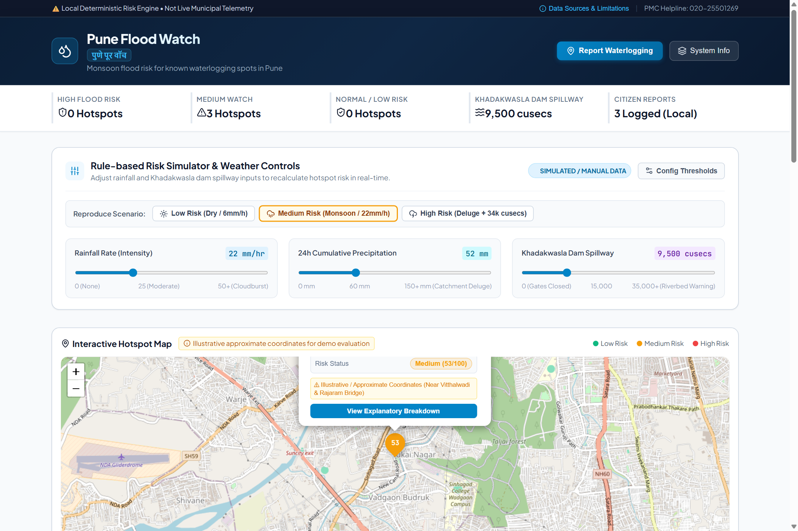
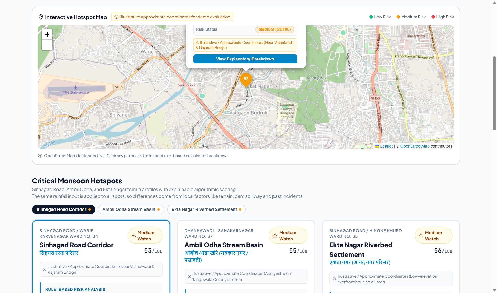
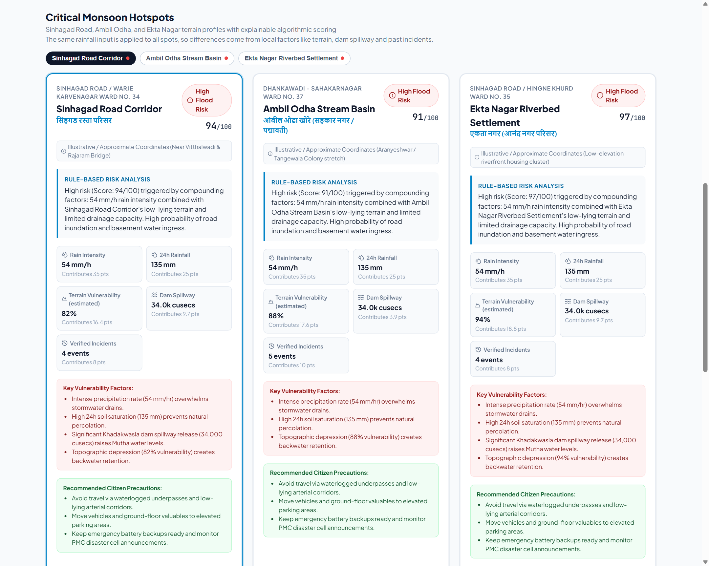
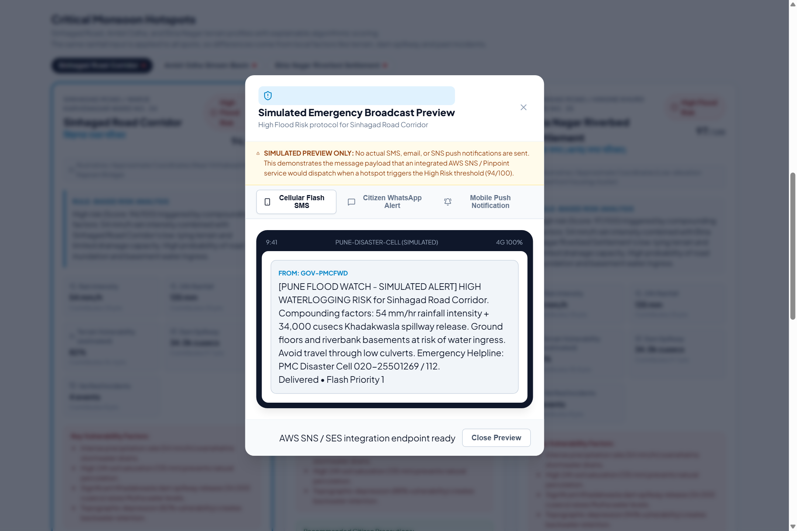
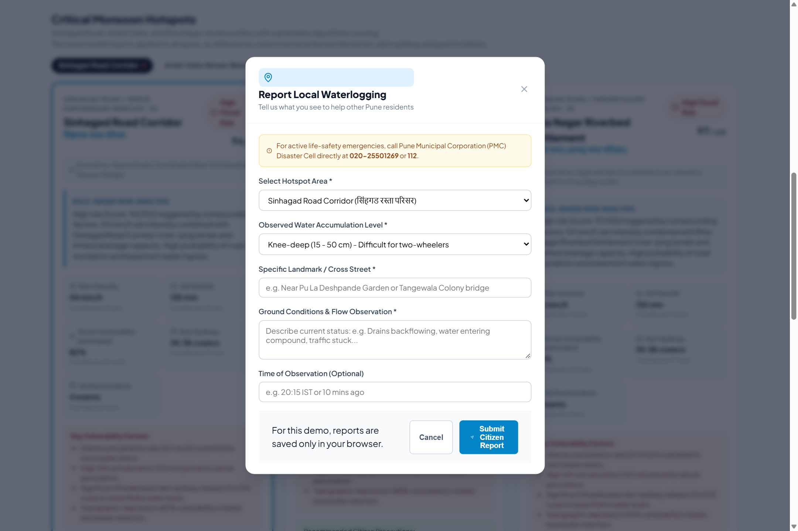
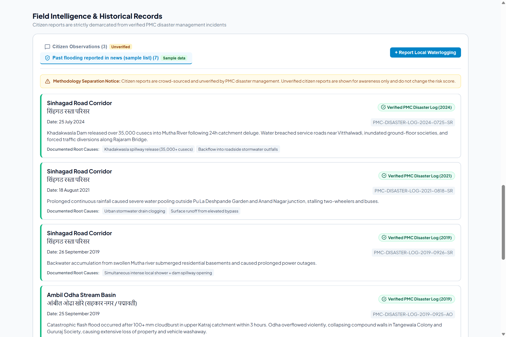
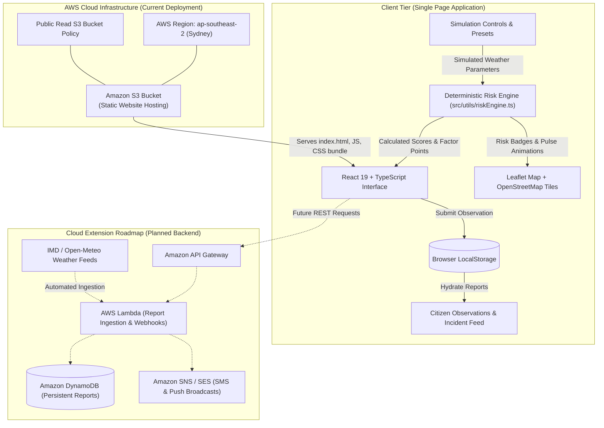

# Pune Flood Watch (पुणे पूर वॉच)

> **Hyperlocal Monsoon Waterlogging Intelligence & Citizen Early Warning Prototype for Pune**  
> Built for **Environmental Hacks** (Bharat Builds Tour by WeMakeDevs, in collaboration with AWS Builder Center) — *Heat and Water Track*.  
> **Team:** Nexovate

[](http://pune-flood-watch-siddhi-2026.s3-website-ap-southeast-2.amazonaws.com/)
[](https://react.dev/)
[](https://www.typescriptlang.org/)
[](https://vitejs.dev/)
[](https://leafletjs.com/)

---

## 🌐 Live Deployed Demo

The application is deployed and served as a high-performance static web application on AWS:

👉 **[Launch Live Demo on Amazon S3](http://pune-flood-watch-siddhi-2026.s3-website-ap-southeast-2.amazonaws.com/)**  
`http://pune-flood-watch-siddhi-2026.s3-website-ap-southeast-2.amazonaws.com/`

> [!IMPORTANT]
> **Hackathon Prototype Disclaimer:**  
> Rainfall intensity, 24-hour cumulative rainfall, and Khadakwasla dam discharge are **simulated inputs** designed to demonstrate responsive flood risk calculations. Sample citizen reports and past flooding records are **curated demonstration data**. This application is an educational prototype and must not be used as an official life-safety warning system. For active emergencies in Pune, dial **112** (National Emergency), **101** (Fire), or call the **PMC Disaster Management Cell at 020-25501269**, and follow official advisories at [pmc.gov.in](https://pmc.gov.in).

---

## 📸 Application Gallery


### 1. Main Dashboard & Live Weather Simulation
Overview of real-time city risk status, summary metrics, interactive scenario presets, rainfall and dam discharge controls, and the geospatial map.


### 2. Interactive Geospatial Hotspot Map
Leaflet-powered map centered over critical river and nala corridors (Sinhagad Road, Ambil Odha, Ekta Nagar) with risk-coded markers and explanatory popups.


### 3. Transparent, Explainable Hotspot Risk Engine
Hotspots under High Risk Deluge conditions showing deterministic point contributions, topographic vulnerability ratings, and citizen safety guidance.


### 4. Multi-Channel Emergency Alert Preview
Simulated multi-channel broadcast interface demonstrating localized emergency payloads across Cellular Flash SMS, WhatsApp, and Mobile Push Notifications in English and Marathi.


### 5. Citizen Waterlogging Observation Intake
Community field observation form capturing street-level water depths (ankle, knee, waist, submerged) and landmarks with clear unverified demarcations.


### 6. Field Intelligence & Verified Disaster Archive
Strict demarcation between unverified citizen observations and archived historical disaster events from news records and municipal reports.


---

## 🎯 The Problem

During the South-West Monsoon, localized pockets across Pune—notably the **Sinhagad Road Corridor**, the **Ambil Odha Stream Basin**, and low-lying riverfront pockets such as **Ekta Nagar**—experience rapid, catastrophic waterlogging. 

Residents face three distinct challenges:
1. **Coarse, City-Wide Forecasts:** Official warnings often cover the entire Pune district or the upper river basin, offering little actionable insight into whether an individual arterial road or society entrance is submerging.
2. **Opaque "Black-Box" Alerts:** Color-coded warnings rarely explain *why* a location is in danger, making it hard to discern whether the threat stems from cloudburst-level local downpours, saturated soils, or Khadakwasla dam spillway gates opening.
3. **Data Pollution & Panic:** Unverified social media rumors can cause panic or skew official response. A reliable system requires strict methodology separation between crowdsourced ground reports and verified flood logs.

---

## ✨ Verified Project Features

- [x] **Hyperlocal Spot-Level Risk Evaluation:** Focuses specifically on vulnerable topographic hotspots (Sinhagad Road / Warje, Ambil Odha / Sahakarnagar, Ekta Nagar / Hingne Khurd) with localized ward metadata.
- [x] **100% Explainable Mathematical Scoring:** Computes risk (0–100) using a transparent weighted formula. Every point contributed is itemized directly on the user interface.
- [x] **Interactive Scenario Simulator:** Allows evaluators to test real-world scenarios in one click or adjust individual parameters:
  - *Low Risk (Dry):* 6 mm/h rain, 12 mm / 24h, 0 cusecs dam discharge (All Low / Green).
  - *Medium Risk (Monsoon):* 22 mm/h rain, 52 mm / 24h, 9,500 cusecs dam discharge (Medium Watch / Amber).
  - *High Risk (Deluge):* 54 mm/h cloudburst, 135 mm / 24h, 34,000 cusecs dam release (High Risk / Red).
- [x] **Dynamic Hotspot Map (Leaflet + OpenStreetMap):** Vector-free interactive map rendering pulse-animated markers, coordinate disclaimers, and interactive inspection popups.
- [x] **Configurable Sensitivity Thresholds:** Evaluator drawer to modify score cutoffs (Low: 35, High: 65) and parameter weights in real time to assess model sensitivity.
- [x] **Multi-Channel Emergency Alert Simulator:** Realistically previews SMS, WhatsApp, and Push Notification payloads in both English and Marathi (मराठी) without dispatching actual messages.
- [x] **Citizen Waterlogging Observations:** Interactive reporting modal with validation, severity classification, and persistence in browser `localStorage`.
- [x] **Strict Methodology Separation:** Distinct tabs and visual tags separating unverified citizen observations from documented historical flooding events (e.g., September 2019 Ambil Odha flash flood and July 2024 Khadakwasla releases).

---

## 🧮 Explainable Risk Scoring Engine

The scoring model is a transparent, deterministic algorithm implemented in [`src/utils/riskEngine.ts`](file:///c:/Users/SIDDHI/pune-flood-watch/src/utils/riskEngine.ts). It avoids black-box machine learning to guarantee clarity and explainability for civic authorities and residents.

$$\text{Risk Score} = \min\left(100, \sum_{i} w_i \times F_i\right)$$

### Factor Breakdown & Normalization

| Factor | Weight ($w_i$) | Scaling Metric ($F_i$) | Rationale & Civic Impact |
| :--- | :---: | :--- | :--- |
| **Rainfall Intensity** | **0.35** | Scaled against 50 mm/h (Cloudburst rate) | Immediate stormwater drain overload |
| **24-Hour Rainfall** | **0.25** | Scaled against 120 mm | Soil saturation & delayed percolation limit |
| **Terrain Vulnerability** | **0.20** | Fixed hotspot estimate (Sinhagad: 82%, Ambil Odha: 88%, Ekta Nagar: 94%) | Topographic depression & natural nala bottlenecks |
| **Khadakwasla Dam Spillway** | **0.10** | Scaled against 35,000 cusecs | Mutha River bank overflow & backwater pressure |
| **Historical Incidents** | **0.10** | Count of verified past flood events | Empirically proven drainage failure history |

### Risk Classifications
- **Low Risk (0 – 34):** Standard monsoon conditions. Stormwater networks functioning normally.
- **Medium Watch (35 – 64):** Caution advised. Water accumulation likely in culverts, basements, and service roads.
- **High Flood Risk (65 – 100):** Dangerous inundation imminent. Mutha backwater ingress and nala overflow likely.

---

## 🏗️ Architecture & System Design



### AWS Hosting Details
- **Service:** Amazon S3 Static Website Hosting.
- **Region:** Asia Pacific (Sydney) `ap-southeast-2`.
- **Bucket Policy:** Configured for public `s3:GetObject` on build artifacts.
- **Deployment Process:** Vite creates an optimized production bundle (`dist/`), which is deployed directly to the S3 bucket root.
- **Zero Credentials in Code:** The repository contains no hardcoded AWS access keys, secrets, or confidential tokens.

---

## 🛠️ Technology Stack

| Layer | Technologies |
| :--- | :--- |
| **Frontend Framework** | [React 19](https://react.dev/) with [TypeScript 5](https://www.typescriptlang.org/) |
| **Build & Tooling** | [Vite 6](https://vitejs.dev/) with Fast Refresh & Tree-shaking |
| **Geospatial & Maps** | [Leaflet 1.9](https://leafletjs.com/) with OpenStreetMap vector tiles & custom markers |
| **Icons & UI Assets** | [Lucide React](https://lucide.dev/) (consistent feather icon library) |
| **Design System** | Custom modern CSS variables, responsive flex/grid layouts, high-contrast dark header |
| **Client Storage** | HTML5 `localStorage` with JSON serialization & safety fallbacks |
| **Testing & Quality** | [Vitest](https://vitest.dev/) for unit tests, [Oxlint](https://oxc.rs/) for ultra-fast linting |
| **Deployment** | [Amazon S3 Static Website Hosting](https://aws.amazon.com/s3/) |

---

## 💻 Installation and Local Development

Follow these steps to run the application locally on your machine:

### Prerequisites
- [Node.js](https://nodejs.org/) (version 18.0 or newer recommended)
- `npm` (bundled with Node.js) or `pnpm` / `yarn`

### 1. Clone the Repository
```bash
git clone https://github.com/your-username/pune-flood-watch.git
cd pune-flood-watch
```

### 2. Install Dependencies
```bash
npm install
```

### 3. Run Unit Tests
Validate the deterministic risk engine scoring formulas and threshold logic:
```bash
npm test
```

### 4. Start Local Development Server
```bash
npm run dev
```
Open your browser and navigate to **`http://localhost:5173`**.

### 5. Build for Production
Create an optimized static distribution bundle in the `dist/` directory:
```bash
npm run build
```

To preview the production build locally:
```bash
npm run preview
```

---

## 🔐 Environment Variables

The current release is an explainable client-side application that relies on deterministic formulas and open Leaflet tile servers. **No API keys or environment variables are required to run the app locally or deploy it to Amazon S3.**

For future serverless extensions (see roadmap below), copy `.env.example` to `.env`:

```env
# Optional Future Backend Integrations (Not required for current prototype)
VITE_AWS_API_GATEWAY_URL=
VITE_MAP_TILE_PROVIDER=https://{s}.tile.openstreetmap.org/{z}/{x}/{y}.png
VITE_ENABLE_LIVE_WEATHER_FEED=false
```

> [!NOTE]
> All sensitive AWS credentials for future Lambda deployments will remain securely stored inside AWS Secrets Manager / Parameter Store and will never be committed to Git.

---

## 🚀 Future Scope & Roadmap

1. **Live Meteorological Ingestion:** Connect to real-time Doppler radar and automated weather stations (AWS) from the India Meteorological Department (IMD) and Open-Meteo APIs.
2. **Khadakwasla Dam Irrigation API:** Ingest live discharge readings from the Maharashtra Water Resources Department to replace simulated cusecs.
3. **Serverless Cloud Architecture:**
   - Deploy **Amazon API Gateway** and **AWS Lambda** microservices to handle crowd-sourced report submissions.
   - Store verified observations in **Amazon DynamoDB** with geo-partitioning.
4. **Automated Notification Gateway:** Integrate **Amazon SNS** (SMS alerts) and **Amazon SES** (Email advisories) to dispatch alerts when a hotspot triggers High Flood Risk.
5. **Computer Vision Flood Depth Estimation:** Enable residents to attach photos, using automated AI validation to verify water depth against street furniture or tires before publishing.
6. **Progressive Web App (PWA):** Enable offline caching of emergency maps and disaster helpline numbers for first responders during power outages.

---

## 👥 Contributors & Acknowledgments

- **Team Nexovate** — Designed and developed for the *Environmental Hacks (Heat and Water Track)* organized by WeMakeDevs and AWS Builder Center.
- **AI Assisted Development:** Built with pair programming and structural architecture assistance from Google Antigravity and Anthropic Claude.

---

## 🚨 Emergency & Civic Contacts (Pune)

| Agency / Service | Contact |
| :--- | :--- |
| **National Emergency Helpline** | **112** |
| **Fire & Rescue Services** | **101** |
| **PMC Disaster Management Cell** | **020-25501269** / **020-25506800** |
| **Pune Municipal Corporation Portal** | [https://pmc.gov.in](https://pmc.gov.in) |
| **Traffic Police Control Room** | **020-26126296** |
